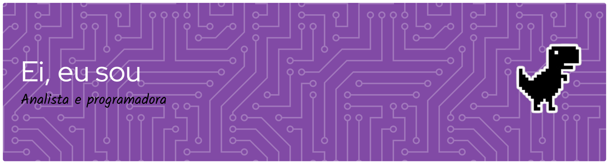

<!--
README do perfil GitHub da Ana Clara (@Dragoniana).
Personalize apenas os links de contato marcados como PREENCHER.
Banner enviado pela própria usuária. As imagens decorativas são URLs indicadas pela usuária.
Cuidado: links externos de DeviantArt usam token e podem deixar de funcionar.
Fontes de inspiração: https://github.com/rafaballerini/PerfilGithub
 https://github.com/abhisheknaiidu/awesome-github-profile-readme
 https://github.com/coderjojo/creative-profile-readme
-->

  

  <h1>Oi, eu sou a Ana Clara! 👋</h1>
  
<b>Hi, I'm Ana Clara! 💜</b>

  
  

    🎓 Engenharia de Software / Software Engineering &nbsp;·&nbsp;
    🏭 Dados industriais / Industrial Data &nbsp;·&nbsp;
    🎨 Código + arte / Code + art
  

---

## ✨ Sobre mim / About me

<table>
  <tr>
    <td width="83%">
      <strong>🇧🇷 Português</strong>
      
Sou <b>Ana Clara, tenho 22 anos</b> e sou estudante de <b>Engenharia de Software</b>. Trabalho como <b>analista de dados industriais com o AVEVA PI</b> e estou construindo meu caminho como <b>desenvolvedora front-end</b>.

      
Transito entre o mundo do código e da arte. Adoro <b>jogos e desenhar</b>, e gosto de explorar como a criatividade pode tornar a tecnologia mais interessante e acessível.

    </td>
    <td align="center" width="17%">
      
    </td>
  </tr>
  <tr>
    <td>
      <strong>🇺🇸 English</strong>
      
I'm <b>Ana Clara, 22 years old</b>, and a <b>Software Engineering student</b>. I work as an <b>industrial data analyst using AVEVA PI</b>, and I'm working toward becoming a <b>front-end developer</b>.

      
I move between the worlds of code and art. I love <b>gaming and drawing</b>, and I enjoy exploring how creativity can make technology more engaging and accessible.

    </td>
    <td align="center">
      
    </td>
  </tr>
</table>

## 🧭 Minha jornada / My journey

<table>
  <tr>
    <td align="center" width="16%"></td>
    <td>
      <b>🏭 Dados industriais / Industrial data</b> 
      Analiso dados industriais com o <b>AVEVA PI</b> e me interesso por soluções que transformem dados em informação útil. 
      I analyze industrial data with <b>AVEVA PI</b> and am interested in turning data into useful insights.
    </td>
  </tr>
  <tr>
    <td align="center"></td>
    <td>
      <b>💻 Desenvolvimento front-end / Front-end development</b> 
      Estou aprofundando meus conhecimentos em <b>HTML, CSS, JavaScript, React e Tailwind CSS</b>, com interesse em criar interfaces bonitas e funcionais. 
      I'm growing my skills in <b>HTML, CSS, JavaScript, React and Tailwind CSS</b>, with an interest in building beautiful, functional interfaces.
    </td>
  </tr>
  <tr>
    <td align="center"></td>
    <td>
      <b>🎨 Criatividade / Creativity</b> 
      Fora das telas de código, gosto de <b>desenhar e jogar</b>. Arte e tecnologia fazem parte de quem eu sou. 
      Outside of coding, I enjoy <b>drawing and playing games</b>. Art and technology are both part of who I am.
    </td>
  </tr>
</table>

## 🛠️ Tecnologias e habilidades / Tech stack & skills

  

    
    &nbsp;&nbsp;
    
    &nbsp;&nbsp;
    
  

  

    
    
    
  

**Linguagens / Languages:** Python · SQL · JavaScript · HTML · CSS  
**Frameworks e bibliotecas / Frameworks & libraries:** React · Tailwind CSS  
**Ferramentas e plataformas / Tools & platforms:** Linux · AVEVA PI  
**Idioma / Language:** Português (nativo / native) · Inglês (básico / basic)

## 🚀 Projetos / Projects

<table>
  <tr>
    <td width="17%" align="center"></td>
    <td>
      <b><a href="https://github.com/Dragoniana/precobao">Preço Bão</a></b> 
      Comparação de preços de medicamentos. 
      Medicine price comparison project.
      
<b><a href="https://github.com/Dragoniana/portal-pims">Portal PIMS</a></b> 
      Ferramentas e soluções para dados e monitoramento industrial. 
      Tools for industrial data and monitoring.

      <a href="https://github.com/Dragoniana?tab=repositories">Ver todos os repositórios / Explore my repositories</a>
    </td>
  </tr>
</table>

## 📊 GitHub em números / GitHub stats

  
  

  

## 📬 Contato / Let's connect

<table>
  <tr>
    <td width="82%">
      
Adoro conhecer pessoas, trocar ideias e aprender com novos projetos.

      
I love meeting people, exchanging ideas and learning through new projects.

      <!-- PREENCHER: substitua os três URLs pelos seus contatos. -->
      
      
      
    </td>
    <td width="18%" align="center"></td>
  </tr>
</table>

  Feito com curiosidade, código e um toque de criatividade. 💜 
  Made with curiosity, code, and a touch of creativity. 💜

